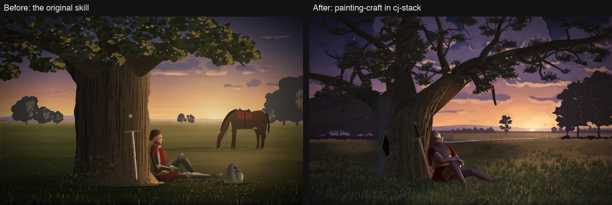
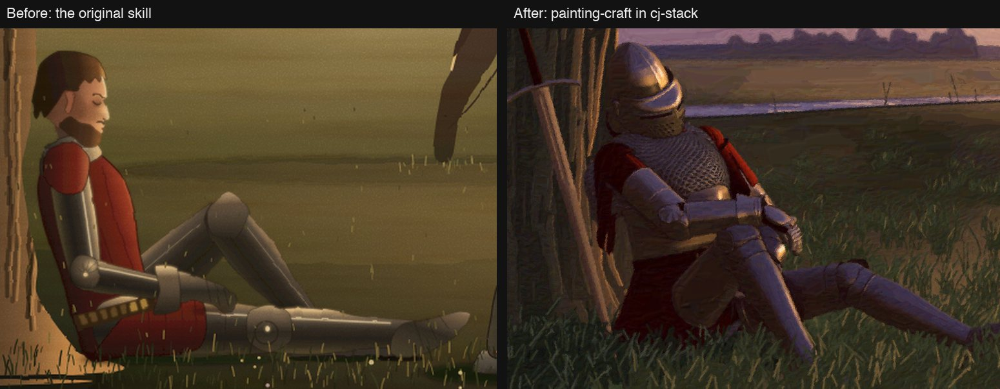
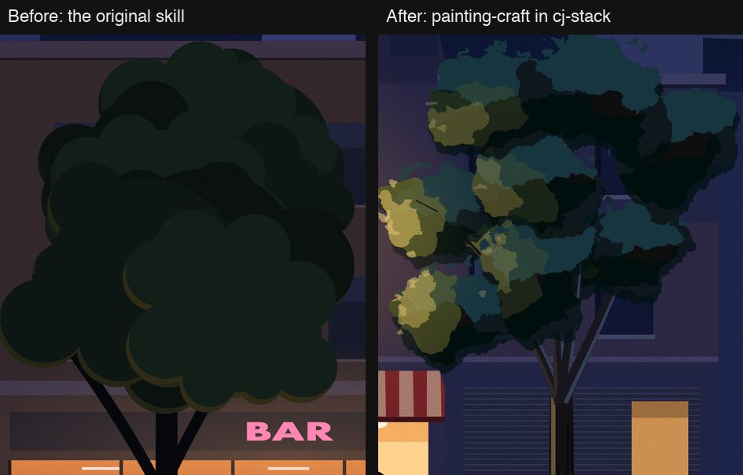

# dotfiles

This repo holds CJ's home folder config and CJ's skills and mods for coding agents.

- The home folder config is a [home-manager](https://nix-community.github.io/home-manager/)
  config. [`flake.nix`](flake.nix) and [`home/`](home/README.md) put the Claude Code, Codex,
  zsh, nvim and tmux config in `~`.
- The skills are in `plugins/`, in five plugins. The mods are in `mods/`.
  [`marketplace.json`](.claude-plugin/marketplace.json) lists both for Claude Code.

A skill is a method that an agent reads when a task needs it. Each skill must work in each
agent tool that CJ uses. [Success in SCOPE.md](SCOPE.md#success) lists these tools. A mod is a
set of hooks for Claude Code only.

- [Home](home/README.md): set up a new machine, change a home file, and sync `settings.json`.
- [Install](#install): install the skills in Claude Code or in another agent tool.
- [Skills](#skills): each skill, its plugin, and what it does.
- [Mods](#mods): each mod and what it does.
- [Models](models/README.md): which model does what.
- [Scope](SCOPE.md): what dotfiles is, its success criteria, and the ideas it rejects, each with
  its reason.
- [painting-craft: before and after](#painting-craft-before-and-after): two pictures from the
  original skill and from the current skill.

## Install

The skills ship in five plugins. Install only the plugins that you need.

| Plugin | What it is for | Skills |
|---|---|---|
| `design` | Sign off UI work and motion. Check it against the design, add missing microinteractions, and make launch videos. | ui-polish, microinteraction, launch-video |
| `engineering` | Prove the work in the real app with unattended builds and loops, user-style testing, change risk, review and PRs. | break-it, review-loop, commit, create-pr, implement, blast-radius, cleanup |
| `planning` | Turn an idea into tickets. Find and test ideas, write the spec, cut thin slices, and triage them in any tracker. | vision, shape, tickets, grill, scout, refine, triage |
| `knowledge` | Keep what the team learns: a decision log, research pages, lessons from past sessions, and a recap of recent work. | dossier, hone, recall |
| `visual` | Paint scenes in code to a gallery standard. | painting-craft |

No plugin holds the engineering principles. They are prompts that you paste into a session, in
[Prompts](#prompts).

### Prompts

This table lists the engineering principles and two rewrite prompts. Each link opens a prompt
that you can copy into a session.

| Prompt | What it finds |
|---|---|
| [Model the Domain](PROMPTS.md#model-the-domain) | All implicit state machines, booleans kept in sync, and branch chains that one table or union would replace. |
| [Foundational Thinking](PROMPTS.md#foundational-thinking) | Logic written before its data shapes, and one capability spread as special cases across callers. |
| [Type System Discipline](PROMPTS.md#type-system-discipline) | Interchangeable primitives, hand-copied schema types, casts on external data and non-exhaustive variants. |
| [Boundary Discipline](PROMPTS.md#boundary-discipline) | Checks inside the system that belong at its boundary, and logic that cannot run without the framework. |
| [Make Operations Idempotent](PROMPTS.md#make-operations-idempotent) | Steps that break when they run twice or after a crash at any point. |
| [Separate Before Serializing Shared State](PROMPTS.md#separate-before-serializing-shared-state) | Two writers on one file, key or branch, to split before you add a lock. |
| [Laziness Protocol](PROMPTS.md#laziness-protocol) | One decision made in two places, and parameters passed through untouched. |
| [Subtract Before You Add](PROMPTS.md#subtract-before-you-add) | Dead code, stubs and guards that no spec or use needs. |
| [Minimize Reader Load](PROMPTS.md#minimize-reader-load) | Wrappers with one caller, and state wider than it needs to be. |
| [Redesign From First Principles](PROMPTS.md#redesign-from-first-principles) | A new flag beside an old path, and the design you would build from zero. |
| [Outcome-Oriented Execution](PROMPTS.md#outcome-oriented-execution) | Shims that exist only to keep a middle step green. |
| [Exhaust the Design Space](PROMPTS.md#exhaust-the-design-space) | The best of 2 or 3 small prototypes, for a decision with no precedent. |
| [Experience First](PROMPTS.md#experience-first) | Options added because they were easy, and reports that list files instead of effects. |
| [Build the Lever](PROMPTS.md#build-the-lever) | Hand edits that a script could do and prove. |
| [Fix Root Causes](PROMPTS.md#fix-root-causes) | Guards for states that must never exist, and sibling copies of the same bug. |
| [Attack the Premise](PROMPTS.md#attack-the-premise) | Fixes that share one untested premise, tested before the next fix. |
| [Prove It Works](PROMPTS.md#prove-it-works) | "Done" that rests on a proxy: a cache, an old build or a self-report. |
| [Test Behavior, Not Implementation](PROMPTS.md#test-behavior-not-implementation) | Tests that pass when behavior breaks, or fail on a refactor. |
| [Explain the Number](PROMPTS.md#explain-the-number) | Numbers with no named limiter: the core, lock, disk or network that capped them. |
| [Sequence Verifiable Units](PROMPTS.md#sequence-verifiable-units) | Checks against a stale base, and commit orders that prove nothing. |
| [Find Implicit Invariants](PROMPTS.md#find-implicit-invariants) | Every invariant the code assumes but never enforces, with the path that breaks it. |
| [Follow the Dependencies](PROMPTS.md#follow-the-dependencies) | Code bolted on against the dependency direction, and the simpler shape the dependencies imply. |
| [Re-pitch](PROMPTS.md#re-pitch) | A rewrite of your last message, with the missing context first and one diagram. |
| [Unslop](PROMPTS.md#unslop) | A rewrite of the same text without the tells of AI-written prose. |

### Claude Code

1. Add the marketplace.
2. Install each plugin that you need, and each mod that you need.

```bash
claude plugin marketplace add cpeaustriajc/dotfiles
```

```bash
claude plugin install engineering@dotfiles
```

To edit a skill or a mod, add your clone as the marketplace in place of the repo:
`claude plugin marketplace add ~/Projects/dotfiles`.

If you installed plugins from the `cj-stack` marketplace before, follow
[Migrate from the cj-stack and cj-lab plugins](MIGRATING.md).

### Other agent tools

To link all the skills into `~/.agents/skills`, run this script from the clone. Codex reads this
folder.

```bash
scripts/link-skills.sh
```

To link them into another folder, give the folder as the first argument. Never give
`~/.claude/skills`, because the plugins already list the skills there. The mods do not work
outside Claude Code.

## Skills

The agent starts a skill when your request matches the skill's description. A typed skill starts
only when you call it by name.

| Skill | Plugin | What it does |
|---|---|---|
| [ui-polish](plugins/design/skills/ui-polish/README.md) | design | Reviews a UI and its motion against the design and a list of common mistakes. It gives a Before/After/Why table. |
| [microinteraction](plugins/design/skills/microinteraction/README.md) | design | Typed, with an area of a web UI. Finds the places that should animate, and plays each proposal before you pick one. It builds nothing. |
| [launch-video](plugins/design/skills/launch-video/README.md) | design | Makes a narrated launch video from a live site or a brief, with a voiceover, music, thumbnails, captions and post copy. |
| [break-it](plugins/engineering/skills/break-it/README.md) | engineering | Drives the app as a careless, impatient or confused user with worst-case data. Reports ranked bugs with screenshots, video and repro steps. |
| [review-loop](plugins/engineering/skills/review-loop/README.md) | engineering | Runs verify, code review and simplify on a change in rounds, until a round changes no code. |
| [commit](plugins/engineering/skills/commit/README.md) | engineering | Typed. Commits the changes in small slices in the repo's style, then pushes. With `local`, it does not push. |
| [create-pr](plugins/engineering/skills/create-pr/README.md) | engineering | Commits, runs the fast checks, pushes, and opens a PR that links the issue and the evidence. |
| [implement](plugins/engineering/skills/implement/README.md) | engineering | Typed, with a ticket or a spec. Builds each ready ticket without supervision, with checked slices, `review-loop` and a PR. |
| [blast-radius](plugins/engineering/skills/blast-radius/README.md) | engineering | Typed, with a change. Finds what the change can break outside its diff, and runs code to prove the fact that makes it safe. |
| [cleanup](plugins/engineering/skills/cleanup/README.md) | engineering | Removes what a session left, such as dev servers, stale branches and the session itself, when it is safe. It does not tidy code. |
| [vision](plugins/planning/skills/vision/README.md) | planning | Asks you about a product idea, first whether it is worth building. Then writes the plan for the product. It does not find ideas. |
| [shape](plugins/planning/skills/shape/README.md) | planning | Writes the spec, milestones and status updates for one project in any tracker, such as Linear, Jira or GitHub. |
| [tickets](plugins/planning/skills/tickets/README.md) | planning | Cuts a spec into thin slices that each cite their requirements, or writes one bug or chore. |
| [grill](plugins/planning/skills/grill/README.md) | planning | Sizes a change, then asks you rounds of questions with a recommended answer each, until no decision is open. |
| [scout](plugins/planning/skills/scout/README.md) | planning | Finds an idea worth building, or checks a niche, when apps are cheap to copy. It gives the best idea to `vision`. |
| [refine](plugins/planning/skills/refine/README.md) | planning | Loops drafted tickets through fact probes and cold reads until nothing is left open, before an agent gets them. |
| [triage](plugins/planning/skills/triage/README.md) | planning | Sets one state on an issue, for "what needs my attention" or "can an agent take this". Writes an agent brief. |
| [dossier](plugins/knowledge/skills/dossier/README.md) | knowledge | Keeps decision and research pages where the team writes, such as a GitHub wiki, Notion, Obsidian or Confluence. |
| [hone](plugins/knowledge/skills/hone/README.md) | knowledge | Finds your repeated corrections in the transcripts on this machine, and proposes where each lesson goes. |
| [recall](plugins/knowledge/skills/recall/README.md) | knowledge | Gives a brief of recent work from transcripts, git and PRs. |
| [painting-craft](plugins/visual/skills/painting-craft/README.md) | visual | Draws and paints in code to a gallery standard, with a screenshot review loop. It is not for UI icons, charts or diagrams. |

A skill holds no harness details and no project facts. The details of a code host or tracker go
in the skill's `references/<host>.md` adapters. A project's own facts stay in that project, or in
the project copy that the skill's setup writes.

## Mods

The mods are Claude Code plugins. To install a mod, run `claude plugin install <mod>@dotfiles`.

| Mod | What it does |
|---|---|
| [hone-nudge](mods/hone-nudge/README.md) | Suggests `/hone <skill>` after you correct Claude during a dotfiles skill. |
| [memory-lint](mods/memory-lint/README.md) | Denies an auto-memory write that holds task state, short-lived detail, PR or commit references, file:line pointers, code, or too much text. A prune always passes. |
| [test-guard](mods/test-guard/README.md) | Off until you run `/test-guard setup` in a project and choose its rules from that project's history. Then it asks you before an Edit or Write rigs a test or, with the full rules, changes a test line at `HEAD`. |

## painting-craft: before and after

Each prompt ran once in a fresh session. The left picture is from the original skill. The right
picture is from the current painting-craft. Nobody touched up a picture by hand.

**"Paint a 1600x1000 SVG of a knight asleep against an oak tree at dusk, in a Romantic oil-painting look."**



At 2× zoom on the knight, the current skill paints a 3D figure that the low sun lights. The
figure has separate plates, rows of mail and a visor. The original skill painted a mannequin of
tubes.



**"Draw a night city street as a 1600x1000 SVG: a car passes behind a row of trees on the near verge.
Flat vector style, but it must not look cheap."**


At 2× zoom on a tree, the current skill builds each crown from clumps on a branch skeleton, in
three values with broken edges. The original skill piled up round blobs.



These changes to painting-craft made the right-hand pictures better:

- Build recipes for the parts that fail up close, in
  [`references/recipes.md`](plugins/visual/skills/painting-craft/references/recipes.md).
- Before the composition, a study of each main subject against public-domain references that
  `scripts/refs.py` fetches and `scripts/compare.py` compares.
- The bundled 3D figure renderer.
- A paint pass that unifies the painted styles, with `scripts/paintpass.py`.
- Delivery at twice the display size.
